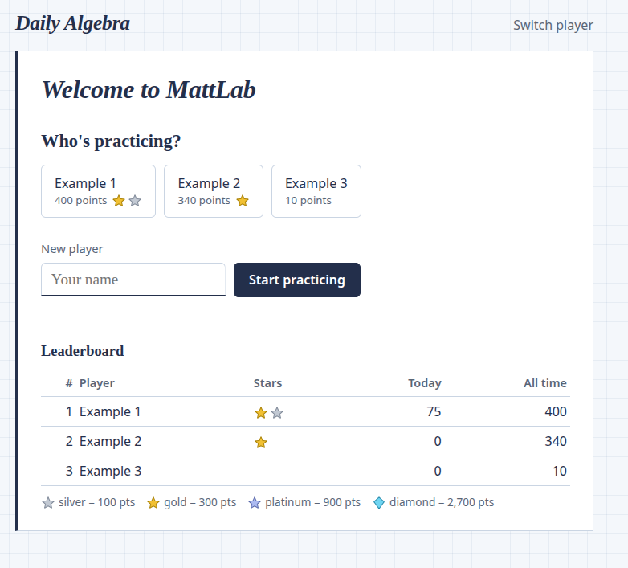

# Daily Algebra

Self-hosted Algebra 1 practice for your home network. Flask + SQLite, no external assets
(works with no internet once it's installed).

- [Install: Linux](#linux) · [Mac](#mac) · [Windows](#windows)
- [Open it from other devices](#open-it-from-other-devices)
- [How it works](#how-it-works) · [Settings](#settings)
- [Troubleshooting](#troubleshooting)

## Install

Each system has two options:

- **Docker (recommended):** runs in the background, restarts on its own, and uses the
  exact Python version the app is tested with.
- **Plain Python:** nothing extra to install beyond Python 3.12, but the app only runs
  while its terminal window is open.

Both keep players and scores in the `data/` folder inside the project, so you can switch
between them without losing anything. Just don't run both at once.

First, get the code, either with git or with **Code → Download ZIP** on GitHub:

    git clone https://github.com/themew2/MattLab.git
    cd MattLab

Run every command below from that `MattLab` folder.

### Linux

**Docker.** Install Docker Engine with the compose plugin. On Fedora:

    sudo dnf config-manager addrepo --from-repofile=https://download.docker.com/linux/fedora/docker-ce.repo
    sudo dnf install docker-ce docker-ce-cli containerd.io docker-compose-plugin
    sudo systemctl enable --now docker

For Ubuntu, Debian, and others, follow
[Docker's install guide](https://docs.docker.com/engine/install/). Then start the app:

    sudo docker compose up -d --build

It starts again by itself after a reboot. To stop it: `sudo docker compose down`.

The container runs as user id 1000 and must be able to write to `data/`. That's the first
user on most Linux systems; check yours with `id -u`. With rootless Podman instead of
Docker, add `userns_mode: keep-id` under the service in `docker-compose.yml`.

**Plain Python** (3.12 recommended):

    python3 -m venv .venv
    .venv/bin/pip install -r requirements.txt
    .venv/bin/gunicorn --bind 0.0.0.0:8080 --workers 1 --threads 4 app:app

Stop it with Ctrl+C.

### Mac

**Docker.** Install [Docker Desktop for Mac](https://docs.docker.com/desktop/setup/install/mac-install/)
and open it once. Then in Terminal:

    docker compose up -d --build

To start it on its own after a restart, turn on **Start Docker Desktop when you sign in**
in Docker Desktop's settings. It starts when you sign in to the Mac, not before.

**Plain Python.** Install Python 3.12 from [python.org](https://www.python.org/downloads/macos/)
or with Homebrew (`brew install python@3.12`). Then in Terminal:

    python3 -m venv .venv
    .venv/bin/pip install -r requirements.txt
    .venv/bin/gunicorn --bind 0.0.0.0:8080 --workers 1 --threads 4 app:app

### Windows

**Docker.** Install [Docker Desktop for Windows](https://docs.docker.com/desktop/setup/install/windows-install/).
It needs WSL 2, which the installer offers to set up. Then in PowerShell:

    docker compose up -d --build

To start it on its own after a restart, turn on **Start Docker Desktop when you sign in**
in Docker Desktop's settings.

**Plain Python.** Install Python 3.12 from [python.org](https://www.python.org/downloads/windows/)
and tick **Add python.exe to PATH**. Then in PowerShell:

    py -3.12 -m venv .venv
    .venv\Scripts\pip install -r requirements.txt
    .venv\Scripts\python app.py

gunicorn doesn't run on Windows, so this uses Flask's built-in server, which is fine for a
home network. The first time it runs, Windows Firewall asks whether to allow Python:
allow it on **private** networks.

## Open it from other devices

On the computer running it, open <http://localhost:8080>. From a phone or another computer
on the same network, use `http://<that computer's IP>:8080`, for example
`http://192.168.1.50:8080`.

| System | Find the IP | Open port 8080 if other devices can't connect |
|---|---|---|
| Linux | `hostname -I` (the first address) | Fedora: `sudo firewall-cmd --permanent --add-port=8080/tcp && sudo firewall-cmd --reload`. Ubuntu: `sudo ufw allow 8080/tcp` |
| Mac | `ipconfig getifaddr en0` (Wi-Fi) | The macOS firewall is off by default. If it's on, allow Docker or Python when asked. |
| Windows | `ipconfig` (the IPv4 Address) | In PowerShell as administrator: `New-NetFirewallRule -DisplayName "Daily Algebra" -Direction Inbound -Protocol TCP -LocalPort 8080 -Action Allow -Profile Private` |

The IP can change when the router restarts. A DHCP reservation on the router keeps it fixed.

Players are name-only, with no passwords. That's fine on a home network, but don't forward
the port on your router or otherwise put it on the internet.

## How it works

- Each day is two rounds of 5 questions, 10 max. Finishing round 1 offers **Play again**
  for round 2. New questions arrive daily at 4pm UTC (noon Eastern in summer, 11am in winter).
- A perfect day (all 10 correct, no skips) unlocks a geometry bonus question worth 100
  points. It's identify-the-concept multiple choice with a picture: one try, no skip, and it
  doesn't count toward the 10.
- Every round has at least one fundamentals question and one word problem, and topics don't
  repeat within a day:
  - Fundamentals (always multiple choice): order of operations, integer operations,
    naming the property, like terms, translating words to expressions, fraction operations.
  - Word problems: rate, consecutive integers, distance, temperature conversion.
  - Core: two-step equations, variables on both sides, distributive property,
    inequalities, slope, slope-intercept form, evaluating expressions, combining like
    terms, exponent rules, factoring trinomials, systems.
  - Bonus geometry: triangles, angles, angle pairs, quadrilaterals, polygons, parts of a
    circle, lines, solids.
- One attempt per question. Correct = 10 points, wrong = 0. The first skip in each round
  earns 5; later skips earn 0. Wrong or skipped questions unlock a step-by-step walkthrough.
  For fundamentals and the bonus, a wrong answer shows the explanation right away, including
  why the picked choice is wrong.
- Multiple-choice right answers are spread evenly across the four positions each day, so
  guessing "always the first one" doesn't pay.
- Leaderboard with stars, on the sign-in screen and after each round. Stars roll up:
  silver = 100 points, 3 silver = 1 gold (300), 3 gold = 1 platinum (900),
  3 platinum = 1 diamond (2,700).
- Typed answers accept `7`, `-2.5`, `3/4`, `1 1/2`, `x = 4`, `- 4`, `$12`. Rounded decimals
  within 0.01 are accepted only for answers with no exact decimal, like 2/3.

## Settings

Set these in `docker-compose.yml`, or as environment variables when running with plain Python.

| Setting | Default | What it does |
|---|---|---|
| `RESET_HOUR_UTC` | `16` | Hour (UTC) when each day's new questions arrive. |
| `POINTS_PER_CORRECT` | `10` | Points per correct answer. The first skip in a round earns half. |
| `BONUS_POINTS` | `100` | Points for a correct bonus question. |
| `SHARED_QUESTIONS` | `0` | `1` gives every player the same questions each day. |
| `DATA_DIR` | `data/` in the project | Where the database and secret key live. |
| `SECRET_KEY` | generated into `data/secret_key` | Signs logins and seeds questions. Changing it logs everyone out and changes today's questions. |

Restart the app after changing a setting. Changing `RESET_HOUR_UTC` or `SHARED_QUESTIONS`
mid-day changes today's questions, so do it right after the daily reset.

## Troubleshooting

Fixes use `manage.py`. Run it from the project folder; the app can keep running.

- **Docker:** `docker compose exec algebra python manage.py <command>`. Add `sudo` in front
  on Linux.
- **Plain Python:** `.venv/bin/python manage.py <command>`, or
  `.venv\Scripts\python manage.py <command>` on Windows.

The examples below use the plain form, `python manage.py`.

### See who's playing and what they answered

    python manage.py players
    python manage.py today "Name"

`today` lists each of the player's answers for the current day, showing round, question
number, right/wrong/skipped, and points.

### Reset a player's entire round

    python manage.py reset-round "Name" 2

The player gets that round's 5 questions back as unanswered.

- **Same questions:** questions come from the player and the date, so they're the same ones,
  and the player has already seen the answers.
- **Points:** anything earned in that round comes off their totals.
- **Round 1 after round 2:** resetting round 1 when round 2 is already played locks round 2
  again until round 1 is finished. Round 2's answers are kept.
- **Bonus:** if the bonus question was answered, it's reset too, because it was only
  unlocked by a perfect day.

### Reset a player's incorrect question

    python manage.py reset-question "Name" 1 3

This reopens round 1, question 3. Use `today` first to find the round and question number.

- Wrong answers scored 0, so no points change.
- The player has already seen the right answer and the explanation.
- Handy for testing the bonus, which needs all 10 correct.

### Rename a player

    python manage.py rename "Old name" "New name"

Points, stars, and history stay with the player, and anyone signed in as them stays signed in.

### Reset a different day

Every command works on the current game day. For another day, add `--day` before the
command:

    python manage.py --day 2026-10-13 today "Name"

### Other problems

- **No new questions after the reset time:** a game day starts at 4pm UTC and is named for
  that date, so check the time in UTC. Reloading the page picks up the new day.
- **Other devices can't connect:** open port 8080 in the firewall
  ([see above](#open-it-from-other-devices)) and check that the device is on the same
  network, not a guest Wi-Fi.
- **Everyone was logged out / today's questions changed:** the `data/secret_key` file was
  deleted or replaced, or `SECRET_KEY` changed. Restore the old key from a backup to undo it.

### Backups

Everything lives in the `data/` folder: `algebra.db` (players and scores) and
`secret_key`. Stop the app and copy that folder to back it up.

## For developers

- **Add a topic:** write a generator in `questions.py` returning `inp(...)` or `mc(...)` and
  add it to `FUNDAMENTALS`, `WORD_PROBLEMS`, `GEOMETRY` (bonus only), or the core part of
  `GENERATORS`. `mc` distractors can be `(choice, mistake)` pairs, to explain a wrong pick.
- **Question privacy:** questions are regenerated from a seed keyed with the server's secret
  plus (player, date), so the server grades without storing them. Answers and solutions never
  reach the browser until the question is answered or skipped.
- **Changes that alter today's questions:** changing a generator, the generator lists,
  `ROUND_SIZE`/`ROUNDS`, the secret key, or the Python version changes questions already
  issued for today. Deploy those changes right after the daily reset.
- **Deleting a player:** the app enables foreign keys, so their attempts are deleted with
  them. The `sqlite3` command-line tool doesn't by default; any attempts left behind are
  cleaned up the next time the app starts.
